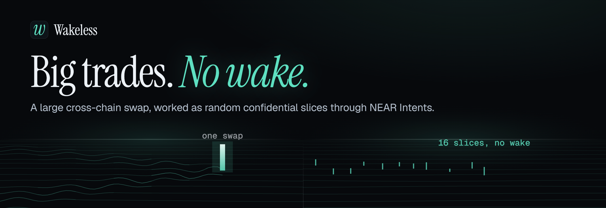

[](https://wakeless.pages.dev)

# Wakeless

Works a large cross-chain swap in randomized slices through NEAR Intents, so
the order pays less price impact and leaves no pattern for wallet watchers to
trade against. A large order leaves a wake; the name is the goal.

Built at NEAR HACKATHON (1 to 14 November 2026). Tracks: Unstoppable DeFi
(`defi`), Agent Economy (`agents`), Privacy & Private AI (`privacy`).

**Live:** [wakeless.pages.dev](https://wakeless.pages.dev), the desk at
[wakeless.pages.dev/web](https://wakeless.pages.dev/web/).

## The problem

One large swap pays for its own size. Extra cost of one swap against a $1,000
swap of the same pair, both quoted by the NEAR Intents 1Click API at the same
moment ([raw quotes](research/impact/), one file per pair and time):

| Pair | Taken (UTC) | $100,000 | $500,000 | $1,000,000 |
| --- | --- | ---: | ---: | ---: |
| USDC (Arbitrum) to SOL | 5 Nov 2026, 02:30 | +8.9 bps | +24.5 bps | no quote |
| USDC (Arbitrum) to SOL | 7 Nov 2026, 07:51 | +5.7 bps | +8.7 bps | no quote |
| ETH (Ethereum) to SOL | 7 Nov 2026, 07:51 | +9.4 bps | +13.0 bps | no quote |
| USDC (Solana) to ETH (Ethereum) | 7 Nov 2026, 07:51-07:52 | +4.1 bps | +7.3 bps | +18.1 bps |

"No quote" is 1Click answering "No liquidity available": above what the
solvers fill at once, one swap does not happen at all. The penalty moves with
the day's liquidity. The same pair cost 24.5 bps extra at $500,000 on
5 November and 8.7 bps two days later.

Trading desks split such orders over time (TWAP). Done in public, the schedule
itself leaks. On Hyperliquid a TWAP is an on-chain action that carries the
wallet, market, side, total size and duration. On 7 November 2026 at 08:28 UTC
a public tracker listed 416 running TWAPs with about $40M ordered, including
ones flagged as randomized ([vike.io](https://vike.io/hyperliquid/twaps)), and
an open-source library reports each slice of a tracked TWAP within about half
a second
([hyperliquid-twap-watcher](https://github.com/LoveBloodAndDiamonds/hyperliquid-twap-watcher)).
Random slice sizes do not hide an order whose total is public. From a normal
wallet on any chain, every slice is a public transaction from the same
address, which tells observers how much is still coming.

## What it does

1. Splits the order into slices with random sizes and random times inside
   their own time slots. The schedule comes from a seed, so it can be replayed.
2. Quotes each slice live through 1Click with every leg inside NEAR Intents
   (`depositType`, `refundType` and `recipientType` are all `INTENTS`), so a
   slice pays no bridge or withdrawal fee.
3. Executes a slice only when its quote is at or above a floor: the price at
   arrival minus the move the client accepts (`maxAdverseBps`). Below the
   floor the slice waits for a later slot, then is left unfilled. The floor is
   never lowered to finish an order. A slice that finds no liquidity is split
   in two.
4. Writes every decision with the raw quote to a JSONL journal and builds the
   execution report from that journal alone.
5. In live mode the wallet holds the order to its slices: the owner signs a
   per-swap cap into the agent's policy, so the whole order as one swap is
   refused whatever the desk sends, and the owner can freeze the wallet to
   stop a running order.

## Try it

Needs Node 22 or later. No keys, no funds, no dependencies to install.

```sh
git clone https://github.com/superskie/wakeless && cd wakeless
```

**Do** `npm test`. **See** 171 passing tests: schedule totals are exact to the
base unit, no fill is ever below the floor, oversized slices split until they
clear (at most three deep), the report math matches a hand-computed case, and
live mode, run against an Agent API double, submits each slice once, in
confidential form, with the floor as its minimum output, and stops when it
should. An upstream that executes a swap and loses every reply still gets
each slice exactly once, and a laptop that sleeps through the window expires
the late slices instead of firing them back to back. The pre-trade check
picks the fewest slices that fit and is not fooled by one lucky quote, and
the exit check flags an address with history. For live mode on the hosted
desk: keccak-256 and the `personal_sign` signer recovery match known vectors,
the page refuses to sign an owner intent that differs from what it asked
for, and the site's proxy forwards only the desk's own calls and refuses any
wallet, grant or intent outside the hosted rules, field by field.

**Do** `npm run impact`. **See** live 1Click quotes for $1,000 to $1,000,000
of USDC (Arbitrum) to SOL (Solana). Cost rises with size, and the largest size
usually returns "No liquidity available". The raw responses are saved to
`research/impact/`. Liquidity changes during the day, so numbers differ from
the table above.

**Do** `node bin/wakeless.mjs plan examples/usdc-arb-to-sol.json`. **See** a
pre-trade check with live quotes: the order cut into 1 to 64 slices, the size
penalty of each slice size against a $1,000 swap quoted the same minute, and
advice. The advice is the fewest slices from which every larger count tried
stays within 2 bps of the $1,000 swap, or one swap when the whole order
already does. One quote per size is noisy, which is why one lucky
reading cannot set the advice. Last, the three things the public chain shows
when the order runs live: one deposit, nothing during, one withdrawal.

**Do** `npm run demo`. **See** a $500,000 order worked in 16 slices: one line
per slice with its live quote and decision, then the report. The 30-minute
schedule runs 60 times faster (about 45 seconds); every quote is live. The
report compares the SOL the slices received with one swap of the whole order
quoted at arrival.

**Do** `node bin/wakeless.mjs report examples/sample-run.jsonl`. **See** the
report in [examples/sample-run.md](examples/sample-run.md) rebuilt offline from
the committed journal of a run on 5 November 2026: the 16 slices received
23.1 bps more SOL than one swap of the whole $500,000 quoted at arrival, about
$1,150. The run was compressed, so the market had little time to move, and at
arrival a slice-sized quote already cost 22.6 bps less than the one-swap quote
taken at the same moment.

**Do** `node bin/wakeless.mjs report examples/sample-run-2026-11-07.jsonl`.
**See** the same order run again on 7 November 2026, when the pair was deeper:
+4.5 bps more SOL than one swap, about $224. At arrival the slice-sized quote
cost 7.0 bps less than the one-swap quote, and later slices were quoted
worse rates than the first (20.7 bps rising to 25.0 bps). The saving is the
size penalty the slices avoid, so it follows the day's liquidity, and
`npm run demo` will print its own number for the market you run it in.

**Do** open https://wakeless.pages.dev, or run `npm run web` and open
`http://localhost:8787/`. **See** the landing page (`web/home.html`): the size
penalty from the committed quotes, the public leak next to the mainnet run,
the desk's own scheduler to play with, the signed policy and its checks, and
every claim with the command or transaction that checks it. **Do** open the
desk at `/web/`. **See** the app only, no explanation: a ticket that works an
order as a dry run in the browser against live 1Click quotes (no wallet, no
key) after an optional pre-trade check, a preview of the ticket's plan (one
possible schedule, drawn by the same function the run uses, under the largest
slice any draw can reach), and replays of the two committed $500,000 runs.

**Do** `node bin/wakeless.mjs check`. **See** whether a partner key is set and the
HTTP status of a public and a confidential dry quote. Without a key the
confidential quote returns 401; the key is never printed.

Your own order: copy `examples/usdc-arb-to-sol.json`, change `sell`, `buy`
and `amount` (assets are `symbol:chain`, such as `usdc:arb`, `eth:eth`,
`sol:sol`), then `node bin/wakeless.mjs run your-order.json --speed 60`.

## How the report measures cost

All costs are in basis points of the input value, measured against the USD
prices 1Click returns with each quote.

- Execution cost: each fill's cost, weighted by size. Fees, spread and price
  impact.
- Implementation shortfall: realized rate against the price at arrival.
  Execution cost plus whatever the market did while the order was worked.
- One-shot alternative: the whole order quoted as a single swap at arrival.
  The comparison uses the amounts received, not USD prices.
- When the USD prices did not change while the order was worked (they update
  every few minutes), the report says so and does not split a market move
  from execution cost.

Every cost includes the 1Click platform fee: 25 bps without an API key, and
with one 20 bps, or 1 bp on stablecoin pairs
([fees](https://docs.near-intents.org/resources/fees)). The fee is a
percentage, so slicing does not add fees, and it cancels out of the
comparison with one swap. The USD prices can lag the market by a few bps, so
only numbers taken at the same moment are compared.

## What is specific to NEAR

- NEAR Intents 1Click quotes 215 tokens on 38 chains through one API
  (`GET /v0/tokens`, 5 November 2026), so the same desk works any pair.
- Slices settle between NEAR Intents balances instead of as separate
  cross-chain transfers: one deposit in, one withdrawal out.
- Confidential Intents settlement has no measured price premium. On
  5 November 2026 at 03:37 UTC, confidential dry quotes (`basic` and
  `advanced`) for USDC on Arbitrum to SOL on Solana returned the same or up to
  4.4 bps more SOL than public quotes taken at the same moment, from $1,000 to
  $250,000
  ([raw quotes](research/confidential/usdc-arb_sol-sol_2026-11-05t03-37-19-519z.json)).
- Live mode runs on the NEAR Intents Agent API: an agent account whose
  owner-signed policy lets it swap and pay the owner's wallet, nothing else.
  The Agent API enforces that policy, not Wakeless. Wakeless adds the floor
  as each swap's minimum output and the rules that stop the desk (see
  [Working an order through the agent](#working-an-order-through-the-agent)).
  The desk sends every swap in confidential form. In the live run below, four
  slices settled while the public `intents.near` ledger showed a zero balance
  for the agent.
- The slice size is a rule of the wallet, not only of the desk: the owner
  signs a per-swap cap into the same policy
  ([The wallet enforces the slicing](#the-wallet-enforces-the-slicing)).

## Live mode

Live mode runs the desk through an agent account on the NEAR Intents Agent
API. The owner signs one policy, and the API enforces it on every action the
desk's grant token asks for:

```json
{
  "actions": ["swap", "withdraw"],
  "confidential": true,
  "destinations": {
    "mode": "only",
    "list": [{ "action": "withdraw", "chain": "base", "address": "<your own wallet>", "memo": null }]
  },
  "budget": { "daily_usd": "250", "weekly_usd": null, "monthly_usd": null },
  "max_actions_per_hour": 120,
  "frozen": false
}
```

The desk can trade the deposited balance and send it to one place only: the
wallet the owner named. `confidential: true` allows the confidential form of
each action, and the desk sends every swap in that form. A leaked grant can
only swap, within $250 a day, or pay that wallet back, and the owner can
freeze the account at any time. The owner is a throwaway EVM key that only
signs these rules: the API derives its NEAR account and sponsors it, so it
needs no NEAR and holds no funds.

The agent starts swap-only (`create`); `allow-withdraw` is the owner's signed
policy update that adds the one withdrawal address, replacing any earlier one.
Before the owner signs it, `allow-withdraw` reads that address through a
public RPC (Base, Ethereum, Arbitrum) and says what a withdrawal to it would
link the order to. An address that has sent transactions, such as the wallet
that paid in, ties the way out to its history; one with no outgoing
transactions and no ETH has none the RPC can see. It warns and does not
refuse. The check itself shows that RPC the exit address together with your
IP, so `--rpc <url>` sends it to an RPC you run or trust and `--no-check`
skips it; nothing is signed until you add `--confirm`.
The live run below withdrew to the wallet that made the deposit, and
the check flags that wallet: it has sent 2 transactions on Base.

Built and checked on the hackathon demo deployment
(`https://api.demo.agentsonintents.com`, mainnet) on 5 November 2026:

- Creating the agent swap-only, and issuing the desk's grant. A dry
  withdrawal through that grant came back with `policy_action_denied`.
- A dry swap of 10 USDC on Base to SOL through the grant returns a quote,
  a `fee` figure (0.18% at the time) and the remaining daily budget.
- The owner's policy update to revision 2, adding `withdraw` to one Base
  address, applied and synced with no gas from the owner. A dry withdrawal of
  0.001 ETH to that address then previewed a 0.11% fee and no policy warning;
  to any other address it came back with `policy_destination_denied`.

To reproduce, you need a demo partner key from
`https://partners.demo.agentsonintents.com/dashboard`. Put it in `.env` as
`NEAR_INTENTS_AGENT_API_KEY`, with
`NEAR_INTENTS_AGENT_API_URL=https://api.demo.agentsonintents.com`. Keys made
before the partner portal (`naa_...`) are refused with `api_key_retired`, and
`live/` uses SDK 0.8.0, which takes the portal's keys. Then:

```sh
cd live && npm install && cd ..
node live/agent.mjs owner     # throwaway owner key, written to .env
node live/agent.mjs create    # swap-only agent (allow-withdraw adds withdraw and the address)
node live/agent.mjs grant     # the desk's grant token, written to .env
node live/agent.mjs quote nep141:base-0x833589fcd6edb6e08f4c7c32d4f71b54bda02913.omft.near nep141:sol.omft.near 10000000
node live/agent.mjs allow-withdraw base <your address> --confirm   # owner signs: withdrawals only there
node live/agent.mjs withdraw nep141:base.omft.near 1000000000000000 base <your address>   # dry preview
```

### Working an order through the agent

`live/run.mjs` runs the same engine with two parts swapped in:

- Prices come from the agent's own swap preview (`dry: true`, confidential
  form) through its grant, so the floor is checked against the route the swap
  will really take, under the agent's policy and budget.
- Each slice that clears the floor is submitted as a confidential swap whose
  `min_amount_out` is the floor, so the floor holds at settlement too, not
  only in the desk's own check. Then the desk follows the swap to a settled
  status and journals the settled amount and the intent hash.

The desk stops instead of guessing: a preview warning (such as
`insufficient_balance` or `spend_budget_exceeded`), a hard refusal, a status
that needs a person (`UNCERTAIN`, `NEEDS_REVIEW`, `PENDING_*`), a swap with
no settled status after 3 minutes, or 3 unfilled attempts in a row. A refunded
swap, or a failed one the API marks as never executed, goes again later under
a new idempotency key, like a slice below the floor. Any other unclear submit
(no answer, a 5xx, a conflict) is retried only under the same key; if that
does not settle it, the desk stops with `UNKNOWN` and the key to look up, so a
slice can not trade twice. A live run also needs a daily limit on the sold
asset equal to the order.

**Do** `node live/run.mjs examples/live-usdc-base-to-sol.json --speed 3`.
**See** 12 USDC (Base) to SOL worked in 4 slices through the agent, each priced
by its own preview. Nothing is submitted and no funds move; with an unfunded
agent every preview carries `insufficient_balance`, and the report lists it.
[examples/agent-preview-run.md](examples/agent-preview-run.md) is such a run
from 5 November 2026. In it the preview's `fee` field tracked the quoted cost,
from 0.25% on the first slice to 0.10% on the last two minutes later, so it
reads as the all-in cost against the API's USD prices rather than a fixed fee.

Live: `node live/run.mjs <order.json> --live --confirm`. It refuses to start
unless the agent's confidential balance covers the order and the wallet's
policy caps the swap size at one slice (next section). To fund it,
`node live/agent.mjs deposit <asset> <amount>` asks for a deposit address with
`confidential: true`, and `node live/agent.mjs shield <asset> <amount> --confirm`
moves a public balance over (without `--confirm` it only previews).

### The wallet enforces the slicing

Slicing is only a promise of the desk's code until the wallet that holds the
funds refuses to break it. The owner signs the slice size into the agent's
policy:

```sh
node live/agent.mjs cap examples/live-eth-base-to-sol.json
```

It sets two of the policy's per-asset limits for the asset the order sells:
`per_transaction`, the largest slice any seed of this order can draw (one slice
with the largest random size and all others with the smallest, plus the
rounding remainder), and `daily`, the order itself. The Agent API checks both
on every swap of every grant before anything reaches the provider. The desk
can not lift them and neither can a leaked grant: the whole order as one swap
is refused, and so is selling more than the order within a rolling day.
`live/run.mjs --live` refuses to start unless the policy lets every slice of
the run through and refuses the whole order; each report states the cap.

**Do** `node live/agent.mjs prove-cap examples/live-eth-base-to-sol.json`.
**See** three dry swaps through the desk's grant: the whole order, exactly the
cap, and one base unit more. On 7 November 2026, policy revision 4
([examples/wallet-cap.json](examples/wallet-cap.json)):

| Swap asked for | ETH | Warnings |
| --- | ---: | --- |
| The whole order as one swap | 0.0025 | `policy_transaction_limit_exceeded`, `insufficient_balance` |
| Exactly the cap | 0.00095588235294118 | `insufficient_balance` |
| One wei above the cap | 0.000955882352941181 | `policy_transaction_limit_exceeded`, `insufficient_balance` |

A dry swap lists as warnings the refusals the live request would get.
`insufficient_balance` is there because the agent was empty after the round
trip below. With 4 slices and 30% size jitter the cap is 38% of the order; for
the 16-slice $500,000 order above it would be 11%.

The policy change is a NEAR transaction
([`Dw4oWNU...`](https://nearblocks.io/txns/Dw4oWNUvgJFmbjC9GGPECvhQT1nF4L2JJRahNt634aqe),
block 223,465,984) whose arguments carry the policy encrypted, next to a hash
of it; the cap does not appear in it in plain text. The time of the change is
public, though, so a cap signed right before an order says an order may be
coming. Sign it well ahead, or keep one standing cap for orders of that size.

### Kill switch

```sh
node live/agent.mjs freeze     # the owner signs agent_freeze
node live/agent.mjs unfreeze   # the owner signs agent_unfreeze
```

A frozen wallet gets no swap, quote or withdrawal from the Agent API, so
stopping a running order needs nothing from the desk. The desk reads that
answer (`wallet_frozen`, or `agent_archived` and `agent_deleted`) as final: it
stops the order at that slice instead of waiting for a later slot, and the
report says why. A freeze skips the API's cooldown between policy changes.

**Do** start `node live/run.mjs examples/live-eth-base-to-sol.json --speed 3`
and run `node live/agent.mjs freeze` from a second terminal.
**See** the desk stop at its next slice. On 7 November 2026 the preview run
started at 12:26:29 UTC and the freeze applied at 12:27:01 (policy revision 5,
[`AcZmj7A...`](https://nearblocks.io/txns/AcZmj7Af45URVgHDsaLG6rbdL2HcSNm8BiywKhjWSkbJ)).
Slice 1, requested before that, was the last one priced. Slice 2, at 12:27:41,
got "The owner froze this agent. Only an agent_unfreeze intent resumes
executions." and the desk stopped:
[examples/freeze-run.md](examples/freeze-run.md), journal
`examples/freeze-run.jsonl`, owner actions in
[examples/freeze-run-chain.json](examples/freeze-run-chain.json). The owner
unfroze the wallet at 12:28:10 (revision 6).

### Live mode on the hosted desk

The web desk works a live order too, owned by the visitor's own wallet instead
of a key in `.env`. Choose Live in the order ticket:

1. Connect an EVM wallet (any EIP-6963 wallet, or `window.ethereum`). It signs
   rules and pays no gas.
2. Name a receive address on the bought asset's chain, and a return address on
   the sold asset's chain for anything unsold. They become the wallet's only
   two withdrawal destinations.
3. Create the agent wallet with three signatures: a `personal_sign` sign-in,
   from which the page recovers the wallet's public key (the Agent API wants it
   for an EVM owner, `src/evm.mjs`); `agent_create` with the policy below; and
   `grant_issue` for this tab, valid for the order plus an hour. The API builds
   the EIP-712 payloads; before the wallet sees one, the page checks it against
   its own request (type, agent, signer, domain, and the policy or the grant's
   commitment and expiry) and shows the API's summary. The wallet signs with
   `eth_signTypedData_v4`; the domain has no chain id, so the wallet does not
   switch networks. After `agent_create` the page reads the policy back and
   goes on only if it is exactly the one signed.
4. Fund it: send exactly the order amount to the confidential deposit address,
   from any wallet or exchange. The page shows the address only if the Agent
   API's answer credits this agent's account, for this asset and amount, in
   confidential form. Nothing outside the Agent API can confirm the address
   itself (1Click's status endpoint does not know these addresses), so it comes
   from the API through this site's proxy. On an EVM chain the page offers to
   send it from the connected wallet, once, with the chain id set; the
   deposit's status and any refund in the public balance are shown.
5. Work the order: the engine, quote client and executor of `live/run.mjs`, in
   real time, in this tab. A funded wallet can run again after a reload or a
   Stop: the page plans the run from what the wallet holds, within the signed
   caps, and signs a new grant if the old one would end first. Stop ends the
   run before its next slice.
6. Withdraw the bought asset to the receive address, and return anything
   unsold. A return above one slice goes out in parts of at most the
   per-transaction limit, which also applies to withdrawals; the daily limit
   can hold the rest for up to a day. These buttons never depend on the token
   price.

Freeze and Unfreeze are owner intents as well. A frozen wallet runs no swap
and no withdrawal (`409 wallet_frozen`), so taking funds out after a freeze
needs an unfreeze first. Freeze works while an order runs, and the button
follows the wallet's frozen state read from the API.

The policy a hosted order gets (`src/agent/hosted.mjs`):

```json
{
  "actions": ["swap", "withdraw"],
  "confidential": true,
  "assets": ["<sold asset>", "<bought asset>"],
  "limits": {
    "per_transaction": { "<sold asset>": "<largest slice the order can draw>" },
    "daily": { "<sold asset>": "<the order>" }
  },
  "destinations": { "mode": "only", "list": ["<receive address>", "<return address>"] },
  "budget": { "daily_usd": "150", "weekly_usd": null, "monthly_usd": null },
  "max_actions_per_hour": 120
}
```

The budget counts swaps and withdrawals alike, so it holds about three times
the $50 order cap. The Agent API wants the partner key on every call and
answers no CORS preflight, so the page calls `/api/agent/*` on its own origin
and a Cloudflare Pages Function (`functions/api/agent/[[path]].js`, the
handler in `src/agent/proxy.mjs`) adds the key from a Pages secret. It forwards
only the ten calls the desk makes. It refuses owner intents that break the
hosted rules: an order above $50 at the Agent API's price, a grant longer than
24 hours, any action but swap and withdraw, more than two destinations, a
budget above $150, or any field outside these rules. The proxy values the
order at the Agent API's token price, read up to five minutes earlier, and
allows 25% drift from the ticket's 1Click price, so the hard server-side bound
is $62.50 of the sold asset per wallet per day; whatever the per-asset limits
do not cover stays inside the $150 daily budget. It also refuses swaps and
withdrawals that are not
confidential, and limits each client address (best effort: each edge instance
counts on its own). `npm run web` runs the same handler with the key from
`.env`, and `npm test` covers its rules (`test/proxy.test.mjs`,
`test/hosted.test.mjs`).

What the cap does not replace: the site's code chooses the rules your wallet
signs, so read the popup; the receive address appears inside the signed
message. These are mainnet funds on code without an audit, and the cap keeps a
mistake small.

Checked on 8 November 2026 on the demo deployment, with throwaway owners and no
funds. A local anvil played the wallet, signing `personal_sign` and
`eth_signTypedData_v4` over JSON-RPC as a browser wallet does, first from a
script and then from the page itself in Chrome:

- the sign-in recovered the wallet's own address and key, and `agent_create`,
  `grant_issue`, `agent_freeze` and `agent_unfreeze` ended `SUCCESS`;
- the policy read back with the slice cap, both destinations and the $150
  budget;
- a dry swap of the whole order came back with
  `policy_transaction_limit_exceeded`, a dry withdrawal to an unlisted address
  with `invalid_address`, and any call while frozen with `wallet_frozen`;
- the proxy refused a $500 wallet, a 30-day grant, a public-form swap and
  `GET /v1/agents`, the list of every agent under the partner key.

No funded order has run from the hosted desk yet; the funded run so far is the
command line one below.

### The live run, 5 November 2026

0.0025 ETH on Base (about $6) went to the agent's confidential deposit address
and was worked into SOL with
`node live/run.mjs examples/live-eth-base-to-sol.json --live --confirm --speed 2`:

- All 4 slices settled (`SUCCESS`), each at or above its floor, for
  0.062710 SOL in total. Each settlement landed between -23.0 and +0.9 bps of
  the agent's own preview for that slice, inside the 1% slippage tolerance.
- [examples/live-run.md](examples/live-run.md) is the report and
  `examples/live-run.jsonl` the journal, with the four intent hashes.
  [examples/live-run-chain.json](examples/live-run-chain.json) lists the
  public facts around it, such as the `intents.near` block where the agent
  showed 0.
- At $6 there is no price impact to avoid, so the slices received 15.5 bps
  less SOL than one swap was quoted at arrival. The run shows the live path
  working; the $500,000 dry run above is the size where slicing pays.
- Then the owner pointed the withdrawal rule at the wallet that made the
  deposit (policy revision 3), the desk swapped the SOL back to ETH, and
  `node live/agent.mjs withdraw ... --execute` paid it out to that wallet on
  Base. The deposit and withdrawal transactions are left out of this repo on
  purpose: they would name the owner's wallet.

What the chain showed while the agent held the SOL:

**Do** `node live/public-view.mjs 0d54a875b32c4ad1668c3e86e807ab28905133c93e1daae19653decaedea079f --block 223137273`.
**See** the agent's balances on the public `intents.near` ledger at that block,
read through an archival node: 0 SOL and 0 ETH, while the Agent API reported
62,710,076 base units of SOL (0.062710076) in the agent's confidential
balance at the same time. It needs no keys. nearblocks.io listed no transactions for the
account, and the API returned no public transaction hash for the four swaps,
only intent hashes. What is public is the way in, the ETH transfer on Base to
the deposit address, and later the way out to the owner's wallet.

## Limits of the dry run

- A dry fill is the amount its quote promised. A real fill can differ inside
  the slippage tolerance (1% by default).
- Dry slices do not use up liquidity, so every slice sees a fresh market. A
  real slice sees that only if market makers refill between slices; only a
  live run measures it.
- With `--speed` above 1 the market has little time to move, so "market move"
  is close to zero. At real speed it is the main risk of slicing, which is
  what the floor is for.
- `run` and `impact` need the 1Click API to be reachable; `report` works
  offline.

## Files

| Path | What it is |
| --- | --- |
| `bin/wakeless.mjs` | Command line: `check`, `impact`, `plan`, `run`, `report` |
| `src/schedule.mjs` | Randomized slice schedule with an exact total |
| `src/guard.mjs` | Execute, wait, split or skip, as a pure function |
| `src/engine.mjs` | Arrival snapshot, slice loop, journal events |
| `src/oneclick.mjs` | 1Click client with retries, quote parsing |
| `src/report.mjs` | Cost report rebuilt from a journal |
| `src/precheck.mjs` | Pre-trade check: size penalty by slice count, advice |
| `live/agent.mjs` | Agent lifecycle on the Agent API: owner, agent, grant, deposit, withdrawal rule, withdraw, slice cap, freeze |
| `live/run.mjs` | Works an order through the agent, preview or live |
| `src/agent/cap.mjs` | The slice cap an order needs, and whether the signed policy holds a run to it |
| `src/executors/agent.mjs` | Submits a slice as a confidential swap with the floor as minimum output (command line and web desk) |
| `src/agent/quotes.mjs` | The agent's swap preview as the price source |
| `src/agent/http.mjs` | Agent API client for the web desk, through the site's proxy, with the SDK's method names |
| `src/agent/hosted.mjs` | Rules for live orders from the hosted site: the policy, the $50 cap, address checks |
| `src/agent/proxy.mjs` | The site's Agent API proxy: an allowlist of calls, the hosted rules, limits per address |
| `src/evm.mjs` | keccak-256, the public key behind a `personal_sign`, EIP-55, ERC-20 calldata; no dependencies |
| `functions/api/agent/[[path]].js` | The proxy as a Cloudflare Pages Function, the partner key as a Pages secret |
| `web/live.mjs`, `web/wallet.mjs` | Live mode of the web desk: the visitor's wallet as owner, deposit, run, withdraw, freeze |
| `live/public-view.mjs` | The agent's public `intents.near` balances, next to its confidential ones |
| `live/exit-check.mjs` | What a withdrawal address would link the order to, read from a public RPC |
| `examples/` | Example orders, committed dry runs, an agent preview run, the live run, the cap check and the frozen run |
| `research/impact/` | Raw price impact snapshots |
| `brand/` | Logo files and `build.mjs`, which outlines them from Instrument Serif and writes the site's favicon and header mark; see `brand/BRAND.md` |

## Related work

Splitting an order over time and executing privately both exist on their
own. Searching GitHub and the web on 5 November 2026, we did not find the two
combined across chains on NEAR Intents.

- Public TWAP: CoW Swap TWAP orders, Jupiter Recurring on Solana and
  Hyperliquid's native TWAP split an order over time inside their own venue,
  and every child order is public. On Hyperliquid the parent order is public
  too, and trackers list it live (see [The problem](#the-problem)).
- Private TWAP: [`Sednaoui/private-twap`](https://github.com/Sednaoui/private-twap)
  (2021) prototyped TWAP swaps through Aztec Connect on Ethereum.
  [Meridian](https://ethglobal.com/showcase/meridian-1x2ef) (ETHGlobal) is a
  treasury agent that converts USDC to EURC on Base in TWAP chunks, with
  Unlink's ZK privacy pool hiding the treasury's identity in its private mode.
  Both work on one chain.
- Sealed orders: [Stillwater](https://stillwater.finance) (a sealed order pool
  on Solana), [Sotto Systems](https://sottosystems.xyz) (drand-timelocked
  orders cleared in uniform-price batch auctions on an EVM chain) and
  [Orcus](https://github.com/HoomanBuilds/orcus) (intents decrypted only inside
  a TEE, settled on EVM testnets and Sui) protect one order at a time inside
  their own venue.
- NEAR Intents itself offers confidential limit orders through 1Click; on
  5 November 2026 its `orderType` accepted `LIMIT` only.
- The DeFi track brief suggests a cross-chain DCA vault: swaps on a schedule,
  each delivered to the user's address on the target chain, to average a
  price. Wakeless works one large order over minutes to hours to cut its price
  impact, randomizes the slices and settles them confidentially, so the
  schedule leaves no public trail.

Wakeless works across chains on the liquidity of the NEAR Intents solvers,
hides the order's shape by randomizing it, settles every slice confidentially,
and runs as an agent whose policy lets it only swap and pay its owner back.

## Built with

The dry run and the web desk use the Node.js standard library only, plus the
1Click API (`https://1click.chaindefuser.com`) as documented at
https://docs.near-intents.org. Live mode (`live/`) adds the
`@near-intents-agent-api/sdk` and `viem` packages for the Agent API
(https://docs.agentsonintents.com). Fonts are self-hosted under the SIL Open
Font License. All code was written during the hackathon window.

## License

MIT
